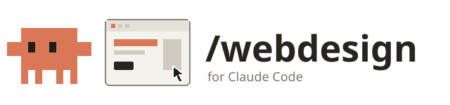
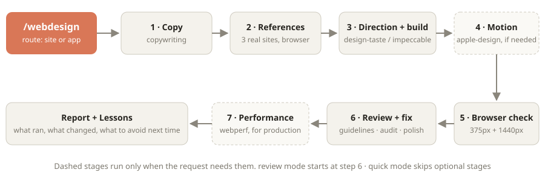

<p align="center">
  
</p>

<p align="center">
  <a href="LICENSE"></a>
  
  
</p>

<p align="center">
  <b>Stop shipping websites that look AI-generated.</b><br/>
  One command runs your request through the best design skills in the right order, studies real well-designed sites first, and checks the result in a browser.
</p>

---

Ask Claude for a website and you usually get the same page: purple gradient, emoji icons, three identical cards. There are great design skills out there, but used together they fight over the look, and nobody makes them run in order.

`/webdesign` is the conductor. Install it once, type one command, and each stage gets one owner skill.

- **Real references, not defaults.** Before designing, it opens 3 well-designed sites in the browser, screenshots them, and writes a brief of patterns worth borrowing.
- **One design lead.** `design-taste-frontend` leads websites and `impeccable` leads apps, so skills never fight over the look.
- **Checked in a real browser.** Every result is screenshotted at phone and desktop width and fixed before you see it.
- **Matches what you have.** When it changes an existing site, it reuses your fonts, colours and spacing, and reverts anything that looks worse.
- **Gets better over time.** It writes down what you rejected and avoids it next run. `/webdesign upgrade` looks for better skills and installs only what you approve.

> **Before you install:** `/webdesign` is free and open source (MIT). It is one instruction file with no code of its own. It opens public websites in your browser for references and installs nothing without asking. [What it does on your computer](#what-webdesign-does-on-your-computer) lists all of it.

## Get started

You need Claude Code. In Claude Code, run:

```
/plugin install webdesign --marketplace ImLiquify/webdesign-skill
```

Or with the skills CLI:

```bash
npx skills add ImLiquify/webdesign-skill@webdesign -g -y
```

Then install the design skills it routes to. Any you skip are reported and skipped, so it works with any subset:

```bash
npx skills add vercel-labs/skills --skill find-skills -g -y
npx skills add vercel-labs/agent-skills@web-design-guidelines -g -y
npx skills add pbakaus/impeccable@impeccable -g -y
npx skills add leonxlnx/taste-skill@design-taste-frontend -g -y
npx skills add nextlevelbuilder/ui-ux-pro-max-skill@ui-ux-pro-max -g -y
npx skills add emilkowalski/skills@apple-design -g -y
npx skills add shadcn-ui/ui@shadcn -g -y
npx skills add coreyhaines31/marketingskills@copywriting -g -y
npx skills add anthropics/skills@frontend-design -g -y
```

Open a new chat and type `/webdesign` followed by what you want.

---

## How it works

<p align="center">
  
</p>

### 1. Copy first

For websites, `copywriting` writes the headline, sections and calls to action before any layout, so the design is built around real words instead of placeholder text.

### 2. References from real sites

It picks 3 well-designed sites in your category (your own picks come first), opens them in the browser at 1440px and 375px, and reads their real font sizes, colours, spacing and corner radius. The result is a short brief: 3–5 patterns to borrow from each site and one thing to avoid. It borrows patterns, never logos, images or text.

```
/webdesign a pricing page, use stripe.com and linear.app as references
```

### 3. One lead designs and builds

| You're building | Lead skill | Helpers |
|---|---|---|
| Website, landing page, portfolio | `design-taste-frontend` | `ui-ux-pro-max` for palettes and fonts |
| App, dashboard, settings, forms | `impeccable` | `shadcn` in React + Tailwind projects |

The lead owns layout, type and colour. Helpers answer specific questions and never override it. The code is written in your project's own stack.

### 4. Motion, only when it's needed

`apple-design` handles springs, gestures and interruptible transitions, but only for pages that have them. Static pages are left alone.

### 5. Browser check

The page is run and screenshotted at 375px and 1440px. What looks wrong gets fixed before you see it.

### 6. Review and fix

`web-design-guidelines` checks accessibility and best practice, then `impeccable` audits and polishes. Small fixes (contrast, alt text, focus rings) go straight in. Anything that adds visible UI goes back through the design lead, reuses your existing style, and is compared before and after. If the new version looks worse, it's reverted.

### 7. Performance, for production

`webperf` checks Core Web Vitals, image weight and render-blocking files, but only when you mention speed or the site is going live.

### Lessons and upgrades

When you say a result looks bad, a one-line rule goes into the skill's **Lessons** list, and every run reads that list first. After 30 days, the end-of-run report reminds you to run `/webdesign upgrade`. That command:

1. updates your installed skills (after asking),
2. searches skills.sh for better ones, keeping only well-installed skills from trusted sources,
3. reads each candidate's files for scripts, network calls and hidden instructions,
4. shows you a table, then installs and wires in only the ones you approve.

---

## Commands

| Command | What it does |
|---|---|
| `/webdesign <request>` | Full pipeline: copy, references, build, motion, browser check, review, performance |
| `/webdesign quick <request>` | Skips optional stages and uses one reference |
| `/webdesign review <what>` | Audits existing UI, reports findings, asks before fixing |
| `/webdesign upgrade [focus]` | Looks for better skills, installs only what you approve |

Installed as a plugin, the command may show as `/webdesign:webdesign`.

---

## Requirements

- **Claude Code.**
- **A browser tool** for references and screenshots: the desktop app's built-in browser, Claude in Chrome, or Playwright. Without one, those stages are skipped and it works from code alone.
- **Optional:** the design skills listed under [Get started](#get-started). Any missing one is skipped.

## What /webdesign does on your computer

A full list, so you know what you're installing.

- **No code of its own.** The skill is one Markdown file of instructions. It runs only when you type `/webdesign`; Claude never starts it by itself.
- **Websites it opens:** the reference sites it picks or you name, plus design galleries like godly.website or land-book.com when it needs ideas. It only reads them. Nothing is logged in, submitted or downloaded.
- **Files it writes:** your project's code, plus `.webdesign/references.md` (the reference brief) if it saves one.
- **Installs:** only in `upgrade` mode, and only skills you approve, via `npx skills add`. It edits its own skill file to route to them.
- **Model calls:** none beyond your normal chat. The skills it loads add to the context of that chat.

## FAQ

**Will it copy other websites?**
No. It borrows patterns like layout, spacing rhythm and hierarchy, and never logos, images, illustrations or text.

**Why one lead skill instead of all of them?**
Design skills have opinions. Two leads on one page give you a mix of two styles. Here, the others only answer questions the lead leaves open, or check its work.

**Can it install things without asking?**
No. `upgrade` shows you every candidate with its install count, source and risk notes, and installs only the ones you say yes to.

**Does it cost money?**
The skill is free. It runs in your normal Claude Code chat and counts toward your usage like any other request.

## License

MIT © Mohamed Kaiser
